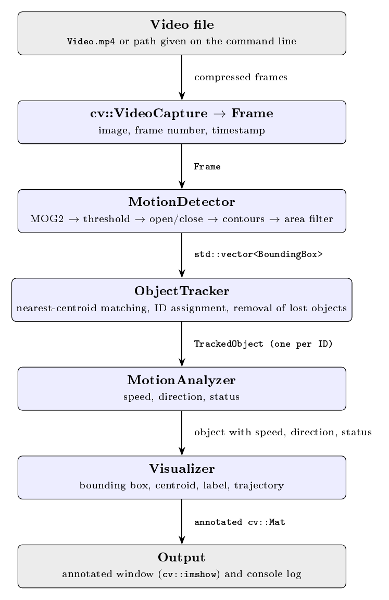

# Object Tracking & Localization Engine

This C++17 application reads a video, detects foreground motion, associates the detections across frames, estimates each tracked region's image-space movement, and displays the result. It uses background subtraction to find moving regions. It does **not** recognize object categories such as car, truck, bicycle, or person.

## Project overview

The application processes one frame at a time. Each frame goes through this sequence:

1. OpenCV's `cv::VideoCapture` decodes the next image from the selected video.
2. The application reads the current frame number and video timestamp, then packages them with the image in a `Frame` object.
3. `MotionDetector` asks OpenCV's MOG2 background subtractor for a foreground mask.
4. The mask is thresholded and cleaned; external contours larger than the configured minimum area become `BoundingBox` detections.
5. `ObjectTracker` compares detection centroids to the centroids of existing tracks. It updates matched tracks and assigns new IDs to unmatched detections.
6. `MotionAnalyzer` compares each track's previous and current centroids and timestamps to calculate displacement, direction, speed, and movement status.
7. `Visualizer` draws the box, ID, centroid, motion label, and trajectory on the original image.
8. The application prints object information to the terminal and displays the annotated image.



The processing uses original-resolution frames. Only the display copy is resized: frames are scaled down as needed to fit within 1280 × 720, with their aspect ratio preserved and without upscaling smaller videos. Thus, the terminal coordinates and tracking calculations remain in original-frame pixels.

## Source files and responsibilities

Every class interface is declared in a header (`.h`), while its method implementations are in the matching `.cpp` file. `main.cpp` connects the classes into the running application.

### `main.cpp`

This is the program entry point and the coordinator for the processing pipeline.

- Uses the first command-line argument as the video path. If no path is supplied, it tries `Video.mp4` in the current working directory.
- Opens the video and reports an error if OpenCV cannot open it.
- Reads each frame and its timestamp using `cv::VideoCapture` properties.
- Creates a `Frame`, detects regions, updates tracks, analyzes them, and draws overlays in that order.
- Prints one record per tracked object per frame. Coordinates refer to the original frame.
- Creates a resizable, aspect-ratio-preserving window and downsizes only the image sent to the display when necessary.
- Stops at the end of the video or when **Q** is pressed, then releases the video and closes OpenCV windows.

### `Frame.h` and `Frame.cpp`

`Frame` packages the data belonging to a single video frame:

- `image`: the frame as a `cv::Mat`.
- `frameNumber`: the sequence number assigned by the application.
- `timestamp`: elapsed video time in seconds.

The parameterized constructor clones the supplied image. `getImage()`, `getFrameNumber()`, and `getTimestamp()` expose the stored values to the detector and other pipeline stages.

### `BoundingBox.h` and `BoundingBox.cpp`

`BoundingBox` represents an axis-aligned rectangular detection using integer `x`, `y`, `width`, and `height` values.

- The `getX`, `getY`, `getWidth`, and `getHeight` methods return the stored coordinates and dimensions.
- `getCentroid()` returns the center as `cv::Point2f`, allowing fractional pixel coordinates.
- `getArea()` multiplies width by height.
- `getRect()` converts the class to OpenCV's `cv::Rect` for drawing and geometry operations.
- `operator+` and `operator-` return a translated box when given a `cv::Point2f` offset; the size is unchanged.

The coordinate origin is the top-left of the image. Positive X points right and positive Y points down.

### `MotionDetector.h` and `MotionDetector.cpp`

`MotionDetector` owns a `cv::BackgroundSubtractor` created with OpenCV's MOG2 implementation. Its `detect(const Frame&)` method returns a `std::vector<BoundingBox>` for one frame.

The method applies this sequence:

1. Return an empty vector if the frame image, subtractor, or configured minimum area is invalid.
2. Apply MOG2 to produce a foreground mask.
3. Threshold the mask at 200. MOG2 marks shadows with a lower mask value, so this threshold generally excludes those shadow pixels.
4. Apply morphological opening to reduce small foreground specks and closing to fill small gaps.
5. Extract external contours. For each contour, use `cv::contourArea` to discard regions smaller than `minimumArea` (default 500 pixels), then use `cv::boundingRect` to create a detection box.

These operations identify foreground motion, not semantic objects. Adjacent moving objects can merge into a single contour, and lighting changes or camera movement can produce false foreground regions.

### `TrackedObject.h` and `TrackedObject.cpp`

`TrackedObject` stores the state for one track ID:

- current `BoundingBox`;
- previous and current centroid;
- a vector of centroid positions forming the trajectory;
- previous and current update timestamps;
- speed, direction, and status strings;
- missed-frame count.

The constructor initializes a new track from its ID, first box, and timestamp. `update(newBox, timestamp)` shifts current position/time into the previous fields, stores the new box and centroid, appends the new centroid to the trajectory, and clears the missed-frame count. `setMotion(...)` stores the calculations made by `MotionAnalyzer`. Getters expose the state to the analyzer, terminal output, and visualizer. The tracker increments the missed-frame count when it cannot match a detection.

### `Tracker.h` and `Tracker.cpp`

`ObjectTracker` (the class name is `ObjectTracker`, although the files are called `Tracker`) stores active `TrackedObject` instances in a `std::map` keyed by ID.

`update(detections, timestamp)` uses a simple greedy nearest-centroid association:

1. Visit existing tracks in ID order.
2. For each track, find the closest detection that has not already been claimed in this update.
3. If the distance is below `maxMatchDistance` (default 80 pixels), update that track and mark the detection as used. Otherwise, increment its missed-frame count.
4. Create a new track and unique ID for each detection not used by an existing track.
5. Erase tracks whose missed-frame count exceeds `maxMissedFrames` (default 5).

Because detections are marked as used, two tracks cannot claim the same detection in one frame. The greedy distance rule is intentionally small and understandable, but it can assign the wrong ID when objects cross, overlap, move farther than the threshold, or are occluded. `getObjects()` returns a reference to the map so `main.cpp` can analyze and draw the current tracks.

### `MotionAnalyzer.h` and `MotionAnalyzer.cpp`

`MotionAnalyzer::analyze(TrackedObject&, deltaTime)` compares the previous and current centroids:

- Displacement is `sqrt(dx * dx + dy * dy)` in pixels.
- Speed is displacement divided by elapsed time, in pixels per second, when the time interval is finite and positive. It uses the object's stored timestamp interval if the supplied interval is not positive.
- Direction is one of `LEFT`, `RIGHT`, `UP`, `DOWN`, or `STATIONARY`, based on the larger coordinate change and the configured movement threshold (default 2 pixels).
- Status is `MOVING` when displacement exceeds that threshold and speed is positive; otherwise it is `STATIONARY`.

The results are stored on the `TrackedObject` using `setMotion`, which lets both the visualizer and terminal output report the same values. This is image-space motion, not calibrated physical velocity.

### `Visualizer.h` and `Visualizer.cpp`

`Visualizer` draws the current track state onto the supplied `cv::Mat`:

- a green rectangle for the bounding box;
- a red point for the current centroid;
- a text label containing ID, movement status, direction, and speed;
- a blue polyline joining the stored centroid trajectory points.

The object-count and FPS text that used to appear in the upper-left corner was removed. The main loop scales the finished image only when preparing it for display.

## How OpenCV is used

OpenCV supplies image, video, geometry, drawing, and window operations:

- `cv::VideoCapture` opens and decodes video frames and provides their timestamps.
- `cv::Mat`, `cv::Point2f`, `cv::Rect`, and `cv::Scalar` represent images and common geometry/color values.
- `cv::BackgroundSubtractorMOG2` models the background and generates a foreground mask.
- Image-processing functions threshold the mask, perform morphology, and find contours.
- The geometry functions `cv::contourArea` and `cv::boundingRect` filter contours and form detection rectangles.
- Drawing functions add boxes, points, text, and trajectory lines.
- `cv::resize`, `cv::imshow`, `cv::waitKey`, and window functions prepare and display the annotated frame.

The current OpenCV 5 package declares `contourArea` and `boundingRect` in the `geometry` component. The project also uses the `core`, `imgproc`, `video`, `videoio`, and `highgui` components.

## How CMake is used

CMake generates the project build files and connects the code to the correct compiler and OpenCV libraries. `CMakeLists.txt`:

- requires MSVC and C++17;
- finds OpenCV 5 and the components used by the application;
- lists every application `.cpp` file in the `ObjectTrackingEngine` executable target;
- adds the include directories returned by the OpenCV package configuration;
- links the OpenCV libraries returned by that package configuration;
- sets the Visual Studio debugger's runtime DLL path and working directory.

`CMakePresets.json` records the Visual Studio 18 2026 x64 generator, `C:/opencv/build` package location, and `build_vs` output directory. It keeps configuration consistent when building from a terminal or VS Code. The `.vscode` tasks call CMake to build the entire target; they do not compile a single source file in isolation.

## Build and run on the configured Windows machine

Requirements: Windows x64, Visual Studio 18 with the MSVC C++ tools, CMake 3.21 or newer, and the OpenCV 5 installation at `C:\opencv` described above.

From a PowerShell terminal opened in the project root, configure and build:

```powershell
& 'D:\CMake\bin\cmake.exe' --preset msvc-x64
if ($LASTEXITCODE -ne 0) { throw 'CMake configuration failed' }
& 'D:\CMake\bin\cmake.exe' --build --preset msvc-debug --parallel
```

Then run the default video:

```powershell
$env:PATH = 'C:\opencv\build\x64\vc16\bin;' + $env:PATH
& '.\build_vs\Debug\ObjectTrackingEngine.exe' '.\Video.mp4'
```

Use a different file by changing the final argument. Quote paths containing spaces, for example `'.\Video 1.mp4'`. If you omit the video argument, the program looks for `Video.mp4` in the current working directory.

OpenCV must be able to decode the MP4's codec. The runtime directory `C:\opencv\build\x64\vc16\bin` must be available on `PATH` when launching from PowerShell; the VS Code debugger configuration supplies it for F5. Debug builds use `opencv_world500d.dll`, and Release builds use `opencv_world500.dll`.

## Limitations

- Use footage from a stationary camera where possible. Camera movement or optical zoom changes the background across many pixels, which MOG2 may interpret as foreground motion.
- Background subtraction finds moving regions; it does not classify them as vehicles, people, or other semantic categories.
- Shadows, changes in lighting, merged contours, and partial occlusion can reduce detection quality.
- Nearest-centroid matching is a basic tracker. It can create new IDs or switch associations in crowded scenes, during crossings, or when objects move farther than the matching threshold.
- Speed is measured in pixels per second. It cannot be interpreted as metres per second without camera calibration and scene measurements.
- There is no line-counting, proximity-warning, or collision-alert feature in this implementation.
